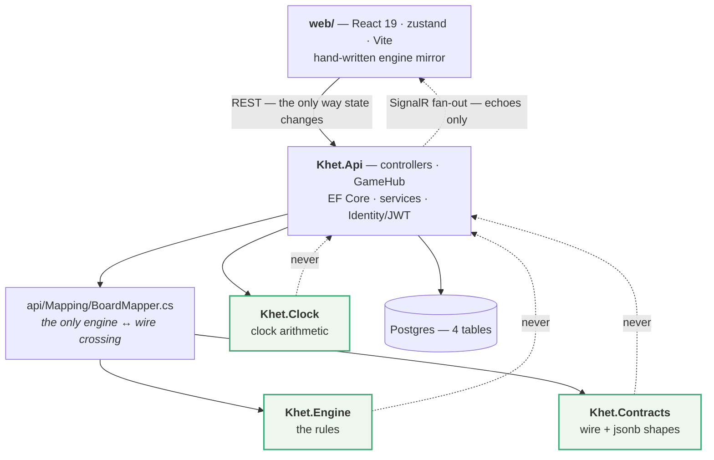
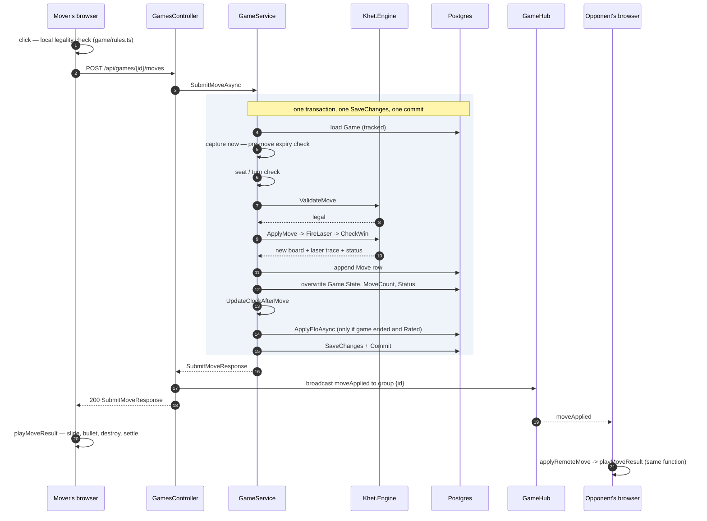
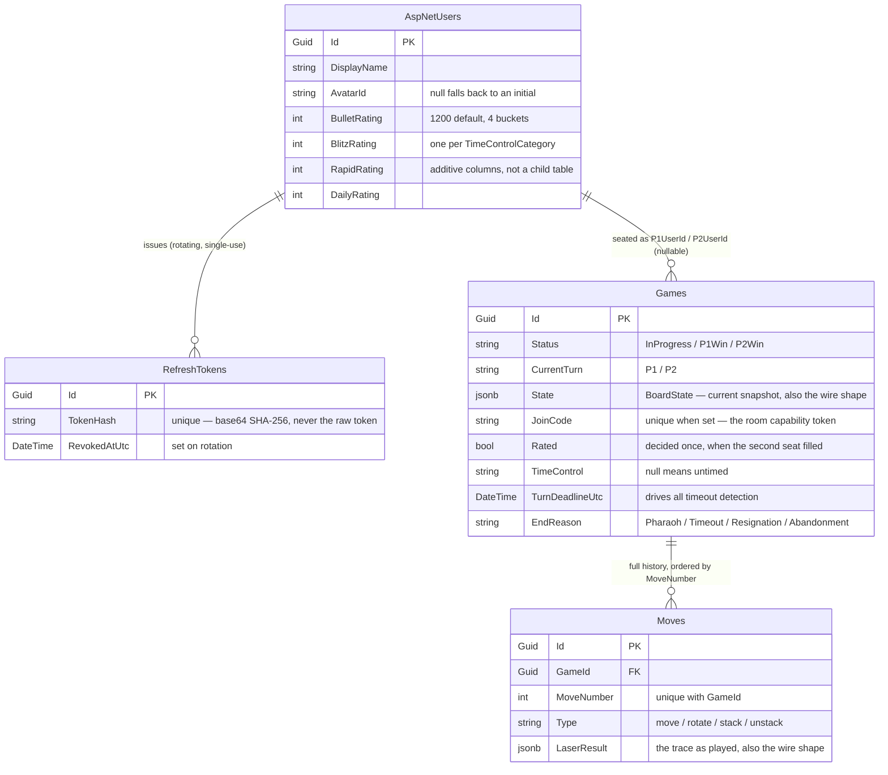
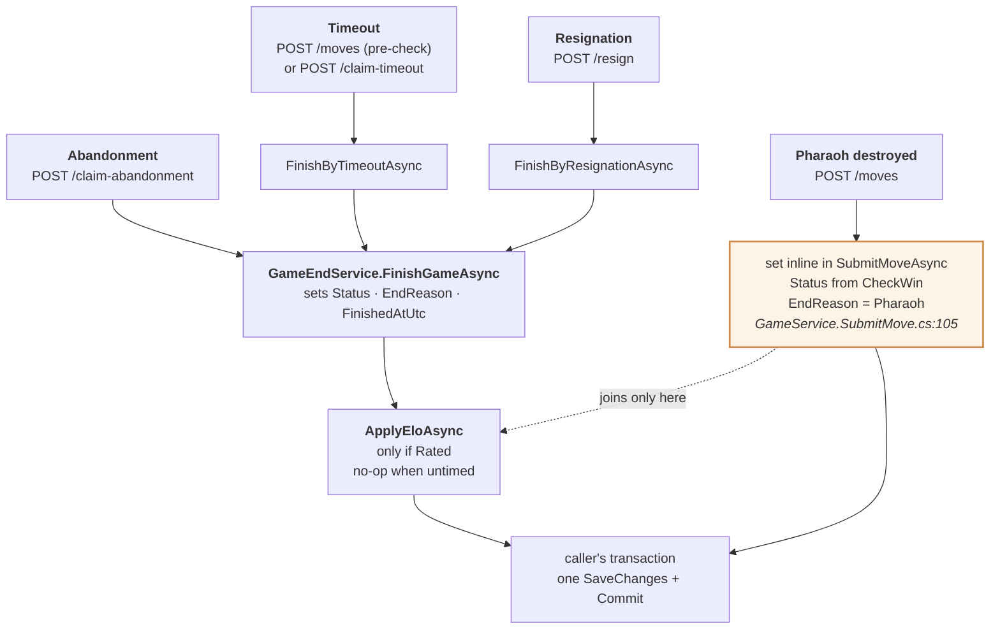
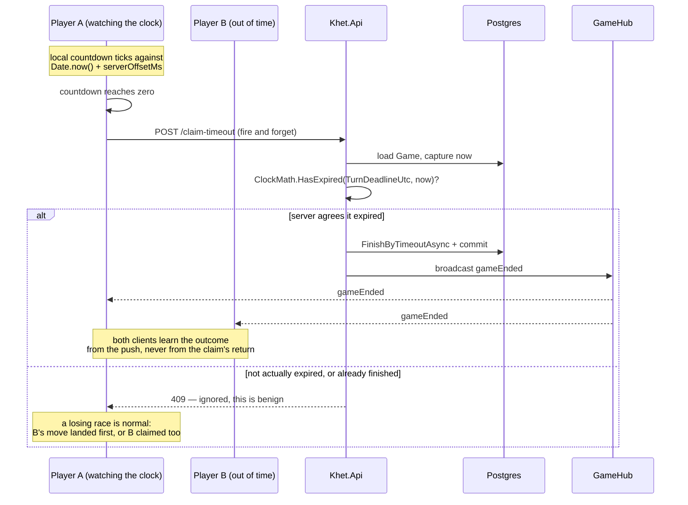

# ARCHITECTURE — how Khet-Web actually works

A guided tour of the whole system, meant to be read start to finish in one sitting. It teaches the
game first and the machinery second, because half the backend is unreadable until you know what a
Djed does.

Everything here is checkable: each claim cites `file:line`. If a cite and the code disagree, the
code is right and this file is stale — fix it.

**Written 2026-09-10, refreshed 2026-09-17.** The core move/clock/data-model spine below (§1–8) has
not changed shape since it was written, but a lot of surface area landed on top of it in between:
an admin surface, friends + match invites, a bot opponent, an installable PWA, login-gating (guest
play was removed — every game now requires an account), and in-app bug-report traceability. None of
that is covered here yet; start from the relevant `backlog/*.md` or the code itself for those. Expect
some `file:line` citations below to be off by a handful of lines from that churn even where the
claim itself still holds.

**How this fits with the other docs.** This file is the *map*. The `CLAUDE.md` files are the
*contracts* for each module (`Khet.Engine/`, `Khet.Clock/`, `Khet.Contracts/`, `web/`, and the repo
root for git/PR conventions). `GOTCHAS.md` is the *trap list* — cross-module things that will bite
you. `README.md` is *setup and deployment*. Read this one first; reach for the others when you are
about to change something.

---

## 1. What Khet is

Khet is laser chess. Two players, an 8×10 board, and every turn ends with a laser firing.

A turn is **one action** — move a piece one square, rotate it 90°, or (Classic only) stack/unstack
obelisks — and then your laser fires automatically from your corner. The beam travels in a straight
line, bounces off mirrored piece faces, and stops when it hits something that absorbs it. Whatever
it hits on a non-mirrored face is destroyed. **Hit a Pharaoh and that player loses.** You can
destroy your own pieces; the beam does not care whose they are.

That is the entire game. Everything in `Khet.Engine` is an implementation of those two paragraphs.

### The pieces

| Piece | Code | What a laser does to it |
|---|---|---|
| **Pharaoh** | `Piece.Pharaoh` | Absorbs and dies. Its owner loses (`Khet.Engine/GameEngine.cs:387`, `CheckWin`). |
| **Pyramid** | `Piece.Pyramid` | Has **one** mirrored corner. Two of its four faces reflect the beam 90°; the other two destroy it. |
| **Djed** | `Piece.Djed` | A double mirror — **every** face reflects, so a laser can never destroy it. It also moves differently: it may swap places with a pyramid or obelisk rather than needing an empty square. |
| **Obelisk** | `Piece.Obelisk` | No mirror. Absorbs the beam and dies — but in Classic it starts **stacked two high** (`Khet.Engine/BoardLayouts.cs:171`, `Health = 2`), so the first hit only knocks it down to one. |
| **Anubis** | `Piece.Anubis` | Khet 2.0 only. A directional blocker: a hit on its **front** face is absorbed harmlessly; any other face destroys it (`Khet.Engine/GameEngine.cs:340-350`). |
| **Sphinx** | `Piece.Sphinx` | Khet 2.0 only. The laser emitter itself, sitting on its owner's corner. Never moves, cannot be destroyed; a turn may be spent rotating it to re-aim the beam. |

Every piece also carries an **orientation** — `NW`, `NE`, `SE`, `SW`
(`Khet.Engine/Enums/Orientation.cs`) — naming which corner its mirror faces. Rotating a piece is
just cycling that value.

### The board, at the start

Rows run 0 (top, P2's home) to 7 (bottom, P1's home); columns 0 to 9. Uppercase = P1, lowercase =
P2. `K`/`k` is a Pharaoh, `O2` a two-high obelisk, and e.g. `PSW` a P1 pyramid oriented SW. This is
`BoardLayouts.Classic` (`Khet.Engine/BoardLayouts.cs:18`) drawn out:

```
        c0    c1    c2    c3    c4    c5    c6    c7    c8    c9
 r0     .     .     .     .     o2    k     o2   pse    .     .
 r1     .     .    psw    .     .     .     .     .     .     .
 r2     .     .     .    PNW    .     .     .     .     .     .
 r3    pne    .    PSW    .    dne   dnw    .    pse    .    PNW
 r4    pse    .    PNW    .    DNW   DNE    .    pne    .    PSW
 r5     .     .     .     .     .     .    pse    .     .     .
 r6     .     .     .     .     .     .     .    PNE    .     .
 r7     .     .    PNW    O2    K     O2    .     .     .     .
```

Two more rules the layout implies. Some squares are **reserved**: all of column 9 plus (0,1) and
(7,1) belong to P1, all of column 0 plus (0,8) and (7,8) belong to P2, and you may not move a piece
onto a square reserved for your opponent (`Khet.Engine/GameEngine.cs:77`, `SquareOwner`). And in
Classic the emitters are **fixed corners** — P1 fires from (7,9) upward, P2 from (0,0) downward
(`Khet.Engine/GameEngine.cs:18-19`).

### One laser, traced

Here is P1's opening beam on that exact board. `[L]` is the emitter, `|` and `-` are squares the
beam merely passes through, and `<...>` marks a piece that reflects it:

```
        c0    c1    c2    c3    c4    c5    c6    c7    c8    c9
 r0     .     .     .     .     o2    k     o2   pse    .     |
 r1     .     .    psw    .     .     .     .     .     .     |
 r2     .     .     .    PNW    .     .     .     .     .     |
 r3    pne    .    PSW    .    dne   dnw    .   <pse>   -   <PNW>
 r4    pse    .    PNW    .    DNW   DNE    .   <pne>   -   <PSW>
 r5     .     .     .     .     .     .    pse    .     .     |
 r6     .     .     .     .     .     .     .    PNE    .     |
 r7     .     .    PNW    O2    K     O2    .     .     .    [L]
```

Up column 9; deflected left by P1's own pyramid at (4,9); left along row 4; turned upward by P2's
pyramid at (4,7); turned right by P2's pyramid at (3,7); turned upward again by P1's pyramid at
(3,9); out of the top of the board. Four reflections, nothing destroyed. That exact path is
asserted segment by segment in `Khet.Engine.Tests/LaserWalkTests.cs:45` if you want to watch it run.

The one thing to internalise: **the reflection table is keyed by the edge the beam ENTERS through,
not the direction it is travelling** (`Khet.Engine/LaserReflection.cs:8-12`). That is an
`Opposite(dir)` flip at the lookup site (`Khet.Engine/GameEngine.cs:314`), and it is the single
easiest thing in this codebase to get backwards — `GOTCHAS.md` opens with a warning about exactly
that.

### Variants

Two dimensions, both chosen at game creation and fixed for the life of the game:

- **Ruleset** (`Khet.Engine/RuleSet.cs`) — `Classic` (stacking obelisks, fixed corner laser) or
  `Khet2` (rotating Sphinx, no stacking).
- **Layout** (`Khet.Engine/BoardLayouts.cs`) — `Classic`, `Khet2Classic`, `Imhotep`, `Dynasty`.

Both follow the same shape as time controls: a small value record, a static dictionary of presets,
and a `For(name)` that throws a specific exception the API turns into a 400. That shape is a house
convention — see the root `CLAUDE.md`.

---

## 2. Five ideas that explain almost everything

If you remember nothing else, remember these. Most "why is it done this way?" questions bottom out
in one of them.

### 1. The server is the only referee

`web/src/game/rules.ts`, `board.ts`, `laser.ts`, `coords.ts` and `inferMove.ts` are a **hand-written
TypeScript copy of `Khet.Engine`**. That looks like an obvious mistake until you see what it buys:
the moment you pick a piece up, the client can highlight legal targets, snap an illegal drag back,
and begin animating before the server has answered. Without a local copy, every interaction would
cost a network round-trip. 

The duplication is safe because the mirror has **no authority**. After the server responds, the
client compares its own computed board against the server's; if they disagree, `matchesServer`
returns false and the client silently discards its own answer and re-reads the server's
(`web/src/game/board.ts:127`, used at `web/src/store.ts:221`). A bug in the mirror degrades an
animation. It can never corrupt a game.

The cost is real and worth naming: a rule change in `Khet.Engine` **must** move the mirror in the
same PR, or the animations quietly drift away from the rules.

### 2. REST decides; the hub only fans out

There is one SignalR hub, `GameHub`, mapped at `/api/hub` (`api/Program.cs:172`). It is the reason
your opponent's screen updates without polling.

It has no authority either. Every broadcast is an echo of something a controller already committed
— see `api/Controllers/GamesController.cs:119`, where `moveApplied` is sent *after*
`SubmitMoveAsync` has returned successfully. No hub method mutates game state. Kill the WebSocket
and the game is still completely playable over REST; you simply stop seeing your opponent's moves
arrive on their own, until the client reconnects and re-syncs (`web/src/realtime.ts:73-76`).

This is what makes the system tractable: **there is exactly one path by which a game changes**, and
it is an HTTP request.

### 3. One POST per turn, and the laser is implicit

There is no "fire laser" endpoint. `POST /api/games/{id}/moves` validates the move, applies it,
fires the laser, checks for a win, banks the clock, and returns all of it in one payload
(`Khet.Contracts/GameApi.cs:99`, `SubmitMoveResponse`).

That is why the client's entire four-phase animation — slide, bullet, destroy, settle — runs off a
single response (`web/src/store.ts:219`). Picking a piece up, previewing, changing your mind: all
client-only, never sent. Exactly one request per committed turn.

### 4. No background timers — "claim" endpoints instead

A chess clock needs someone to notice when it hits zero. The obvious design is a server-side timer
or a background worker sweeping for expired games. This codebase deliberately does neither.

Instead: the server records `TurnDeadlineUtc` on the game row, and exposes
`POST /api/games/{id}/claim-timeout`. Whoever notices first — usually the opponent's own countdown
hitting zero — calls it, and the server **re-checks its own clock** before agreeing
(`api/Services/GameService.Endings.cs:33`). It never takes the caller's word that time expired.
Abandonment works identically through `claim-abandonment` and a 45-second grace period
(`api/Services/GameService.Endings.cs:22`).

The payoff: no scheduler, no background process, and no "what happens if the server restarts
mid-game" question. A timestamp on the row plus an authoritative endpoint is the whole mechanism.
Reuse this pattern for anything else clock- or connection-shaped.

### 5. One captured `now` per request

Inside `SubmitMoveAsync` the wall clock is read exactly once, up front
(`api/Services/GameService.SubmitMove.cs:29`), and that single instant drives the expiry check, the
post-move clock update, and the response's `serverNowUtc`. A second `DateTime.UtcNow` later in the
method would change timing semantics subtly and **no test would catch it**.

The clock is injected as `TimeProvider` (`api/Program.cs:43`) rather than read statically — which is
what lets integration tests substitute a fake clock and assert on expiry deterministically.

---

## 3. The shape of the system



The three highlighted projects are **pure**: no `PackageReference`, no `ProjectReference`, nothing
but the .NET base class library. `Khet.Api` depends on all three; none of them depends on anything.
The project files enforce that direction, not convention, and keeping it that way is the whole point
of the extraction work.

| Project | One sentence | You open it when |
|---|---|---|
| `Khet.Engine` | The rules of Khet, as pure functions over an immutable `Board`. | Move legality, the laser trace, win detection, a new layout or rule variant. |
| `Khet.Clock` | Clock arithmetic and the time-control preset catalog. | A clock formula, a new time-control preset. **Not** clock *scheduling* — that lives in `Khet.Api`. |
| `Khet.Contracts` | The ~40 request/response records, two of which are also jsonb column shapes. | Adding or changing an API field. |
| `Khet.Api` | Everything else: HTTP, the hub, EF/Postgres, Identity, all orchestration. | Anything not covered above. This is the fallback. |
| `web` | The React client. | Any UI, animation, or client-state change. |

`api/Mapping/BoardMapper.cs` is worth singling out. `Khet.Engine` has its own board types (`Board`,
`PieceOnBoard`, typed enums); `Khet.Contracts` has parallel wire types (`BoardState`, `BoardPiece`,
everything stringly-typed). They are deliberately separate — that string boundary is what stops the
engine's domain types leaking into the database and the HTTP contract — and `BoardMapper` is the one
place the two meet. Two shapes for one concept is a real cost, paid on purpose.

---

## 4. One move, end to end

This is the spine of the application. Follow it once and most of the codebase falls into place.



### On the client, before the request

You click a square. `web/src/components/Board.tsx:92` calls a handler that either selects a piece or, if one is already
selected and the square is a legal target, calls `moveTo` on the zustand store
(`web/src/components/Board.tsx:57`). "Legal target" here means legal *according to the mirror* —
`web/src/game/rules.ts` computed the highlight set when you selected the piece.

`store.ts`'s `submit()` (`web/src/store.ts:268`) checks it is actually your turn, sets `busy: true`
to lock input, and POSTs. Nothing has been animated yet.

### On the server

`GamesController.SubmitMove` (`api/Controllers/GamesController.cs:111`) is a thin shell — it calls
the service and translates the result into an HTTP status. All the work is in
`GameService.SubmitMoveAsync` (`api/Services/GameService.SubmitMove.cs:16`), which is worth reading
top to bottom because it is only ~130 lines and it is the one place everything converges:

1. **Open a transaction** (`:18`) and load the `Game` row *tracked*, so EF will write back changes.
2. **Reject a finished game** (`:23`).
3. **Capture `now` once** (`:29`) — see idea 5.
4. **Pre-move expiry check** (`:35`). If the mover's clock already ran out, the move is *never
   applied*; the game ends by timeout instead and the endpoint returns 409. This is checked before
   validation deliberately, so an out-of-time player can never sneak a move in.
5. **Seat check** (`:45-51`) — for room games, if the caller declared a seat it must match whose
   turn it is. Spectators are rejected here.
6. **Translate the request into engine terms** (`:56`, `BoardMapper.ToEngineMove`) and load the board
   out of the jsonb column (`:63`).
7. **Run the engine** (`:66-73`): `ValidateMove`, then `ApplyMove`, then `FireLaser`, then
   `CheckWin`. Four pure function calls; no I/O, no clock, no database.
8. **Persist** (`:78-96`): append a new `Move` row, and overwrite `Game.State` with the post-laser
   board. Note the comment at `:76` — the row is added to `db.Moves`, not to `game.Moves`, because
   EF would otherwise treat a client-set Guid key discovered through the navigation collection as an
   update rather than an insert.
9. **End the game or bank the clock** (`:97-116`) — mutually exclusive. If the laser hit a Pharaoh,
   the win is recorded; otherwise the mover's remaining time is updated for the turn that just
   started.
10. **Apply Elo** if the game ended and it was rated (`:121-122`).
11. **One `SaveChanges`, one commit** (`:124-125`). The `Move` insert, the `Game` rewrite and both
    players' rating updates land together or not at all.

That atomicity depends on every collaborator sharing the same `KhetDbContext`, which is why
`GameService`, `GameEndService`, `GameClockLifecycle`, `GameResponseMapper` and `RoomService` are all
registered `AddScoped` (`api/Program.cs:45-56`). Registering any of them `Singleton` or `Transient`
with its own context would silently break the transaction **with every behavioural test still
green** — so there is a dedicated guard test for the DI lifetimes
(`api.tests/Services/ServiceRegistrationTests.cs`). `GOTCHAS.md` says "believe them"; believe them.

### Back on the client

The response comes back to the mover, and the same payload goes to everyone else in the game's
SignalR group as `moveApplied` (`api/Controllers/GamesController.cs:119`).

Here is the part that is genuinely non-obvious the first time: **the mover and the opponent animate
through the same function.** The mover reaches it directly from the POST response
(`web/src/store.ts:302`); the opponent reaches it from the hub push via `applyRemoteMove`
(`web/src/store.ts:519`), which first has to *reconstruct* what move was played by diffing the old
board against the new one (`inferMove`). If it cannot, it skips the slide and still plays the beam.

`playMoveResult` (`web/src/store.ts:219`) then runs four phases off that single payload:

```
  t=0                 200ms                  ~+Nms                +420ms
  |------ slide ------|------- bullet -------|---- destroy ------|-- settle
  |                   |                      |                   |
  piece moves;        beam polyline draws    hit pieces          board replaced
  turn/status/clock   along laserSegments;   scale-fade out      with the server's
  update immediately  sound fires here                           own boardState

  <------------------------ busy: true, input locked ----------------------->
                                                                  busy: false
                                                          then drainPending()
```

The `slide` and `destroy` durations are user settings (`moveMs` 200ms, `deathMs` 420ms by default,
`web/src/settings/displaySettings.ts:44-45`); the bullet's duration is computed from the beam's
actual path length at a constant 12 squares/second (`web/src/store.ts:249`), so a long reflected
path takes proportionally longer. The same settings are read independently by `LaserLayer.tsx` and
`PieceOnBoard.tsx` to drive their own CSS/SVG animations — the timing contract between the three is
implicit, so if you change one, check the others.

A remote move that arrives mid-animation is not dropped and not played on top — it is queued in
`pendingRemote` and drained once the current sequence settles (`web/src/store.ts:262`, `:526`).

Finally, the settle step is where the mirror gets overruled: the client compares its own computed
board to the server's and, on any mismatch, throws its own away (`web/src/store.ts:221`).

---

## 5. The data model

Four tables. That is the entire schema.



Three things about this schema are worth understanding properly.

**`Game.State` is a snapshot; `Moves` is the history.** One transaction per move rewrites the
snapshot and appends a row (`api/Domain/Game.cs:6-10`). Reading the current position is one row
read, no replay.

**The two jsonb columns are also the wire shape.** `Game.State` is a `Khet.Contracts.BoardState` and
`Move.LaserResult` is a `Khet.Contracts.LaserResult` — the exact same records the API returns. There
is deliberately one representation, not a storage shape and a separate DTO
(`Khet.Contracts/CLAUDE.md`). The consequence to keep in mind: **renaming a property on those
records is simultaneously an HTTP breaking change and a change to the shape of every row already in
the database.**

**No per-move board is stored.** `GET /api/games/{id}/moves` rebuilds every historical position by
replaying the stored moves through the real engine from the starting layout
(`api/Services/GameService.cs:85-95`). Replay can therefore never disagree with the rules, and
adding a rule fix retroactively corrects old games' replays. The cost is CPU on read, which for a
game of a few dozen moves is nothing.

### The frontend mirrors these types, and renames three of them

`web/src/api/types.ts` is a hand-written mirror of `Khet.Contracts`, kept in sync by PR discipline
rather than codegen. Most names match. Three do not, which quietly breaks searching across the
stack:

| `Khet.Contracts` | `web/src/api/types.ts` |
|---|---|
| `MoveHistoryResponse` | `GameHistoryResponse` |
| `LaserResultSegment` | `LaserSegment` |
| `SubmitMoveRequest` | `MoveRequest` |

The mirroring is deliberate; these renames are not. Aligning them is a mechanical follow-up, not
done here to keep this a docs-only change.

---

## 6. How a game ends

Four ways, and they are not perfectly symmetrical. This is the most confusing corner of the
codebase, so it is worth a picture:



Three endings converge on `GameEndService.FinishGameAsync` (`api/Services/GameEndService.cs:59`),
which sets `Status`, `EndReason` and `FinishedAtUtc` and applies Elo. **The Pharaoh win does not** —
it is set inline in `SubmitMoveAsync` (`api/Services/GameService.SubmitMove.cs:105`) because the
winning status comes out of `CheckWin` mid-method rather than being passed in as a `winner`
argument. It rejoins the shared path only at `ApplyEloAsync`. Unifying the four is a known,
deliberately-deferred follow-up recorded in `GOTCHAS.md`.

`GameEndService` has a strict contract worth knowing: **it never saves and never opens a
transaction** (`api/Services/GameEndService.cs:18-21`). It mutates tracked entities and returns; the
calling entry point on `GameService` owns the transaction and the single `SaveChangesAsync`. That is
what lets a timeout resolve identically whether it was caught by a submitted move or by the claim
endpoint.

**Elo** (`api/Services/EloService.cs`) is a plain pure function applied to whichever rating bucket
matches the game's time-control category. Two rules that surprise people: a game is only `Rated` if
both seats were already authenticated at the moment the second seat filled
(`api/Services/RoomService.cs:83-84`) and it never flips true afterwards; and an **untimed** rated
game moves no rating at all, because there is no category bucket to attribute it to
(`api/Services/GameEndService.cs:85-86`) — the same rule chess.com uses.

One rough edge to be aware of: the four end reasons are free-standing string literals
(`"Pharaoh"` in `api/Services/GameService.SubmitMove.cs:106`, `"Timeout"`/`"Resignation"` in `GameEndService.cs:40,49`,
`"Abandonment"` in `api/Services/GameService.Endings.cs:97`), documented at `api/Domain/Game.cs:118-125` but not
enforced by a shared constant.

---

## 7. Clock, connections, identity

### The clock

Multiplayer rooms only — local games created through `POST /api/games` are always untimed
(`api/Domain/Game.cs:83-90`). Thirteen presets across four categories (Bullet, Blitz, Rapid, Daily)
live in `Khet.Clock/TimeControl.cs`.

It **starts when the second seat fills**, not at room creation (`api/Services/RoomService.cs:89-90`)
— otherwise the host would burn time waiting for someone to join. Live categories bank a remaining
balance per player plus an increment; Daily has no balance at all, just a deadline that resets every
move. Both are detected identically, through `TurnDeadlineUtc` (`api/Domain/Game.cs:109-116`), which
is why there is one timeout mechanism rather than two.

The client **never ticks against its own clock**. Every payload carrying clock fields also carries
`serverNowUtc`; the client computes `offset = serverNowUtc - Date.now()` on each one and ticks
against `Date.now() + offset` (`web/src/store.ts:197-206`). Client clock skew is common and would
otherwise show a wrong countdown or fire a spurious claim.

And here is the claim pattern in full, including the race that makes a 409 normal:



Claims are **fire-and-forget** on the client (`web/src/store.ts:554`, `:570`): the return value is
ignored and a 409 is expected. The authoritative outcome always arrives as a `gameEnded` push or on
the next `resync()`. `resign()` is the one exception — a deliberate user click, so a failure *does*
surface in the error banner (`web/src/store.ts:587-590`).

### Connections

`GameConnectionTracker` (`api/Hubs/GameConnectionTracker.cs:16`) is a process-wide singleton mapping
connection id to (game, seat). It is **in-memory only and never persisted** — a restart forgets
every entry, which is fine, because it is not a source of truth for anything. It only exists so
`GameHub.OnDisconnectedAsync` can stamp `P1DisconnectedAtUtc`/`P2DisconnectedAtUtc` on the game row
and broadcast `opponentDisconnected`. What actually ends an abandoned game is the claim endpoint
re-checking that timestamp against a 45-second grace period.

A `Join` clears the timestamp again (`api/Hubs/GameHub.cs:31`), which covers both a genuine
reconnect and an ordinary page refresh — the hub cannot tell them apart, and does not need to.

### Identity

JWT bearer tokens, no cookies, no roles (`AddIdentityCore`, not `AddIdentity` —
`api/Program.cs:63-76`). Refresh tokens are **rotating and single-use**: each refresh revokes the
old one and issues a new pair, and only a SHA-256 hash is stored (`api/Domain/RefreshToken.cs`).

That rotation forces a subtlety on the client. If two requests 401 at the same time and each tries
to refresh, one wins and the other fails against an already-rotated token. So every refresh — the
retry path and the boot-time `hydrate()` alike — funnels through one shared in-flight promise
(`web/src/api/refreshSession.ts`). Tokens live in `localStorage`; the XSS tradeoff is consciously
accepted and documented at `web/src/authStore.ts:13-19`.

One transport wrinkle: browsers cannot set an `Authorization` header on a WebSocket upgrade, so
SignalR sends the token as `?access_token=` instead. The API honours that **only** for the `/api/hub`
path; every other endpoint still requires a real header (`api/Program.cs:112-121`).

### Seat vs. account vs. rated

This is the subtlest rule in the codebase, and it is worth reading `api/Domain/Game.cs:46-65` for
yourself. Three separate concepts:

- **Seat** — P1 or P2 in a room. Claimed by whoever creates or joins first. The join code is the
  capability token for the room itself; note that the app is now gated behind login end to end
  (guest play was removed after this was first written), so in practice every seat already carries
  an account by the time the room is joined.
- **Account** — `P1UserId`/`P2UserId`, nullable. Set at create/join if the player was logged in, or
  attached later through `POST /api/games/{id}/claim-seat` if they log in mid-game (so the game
  shows up in their archive).
- **Rated** — set true exactly once, by `JoinRoomAsync`, if *both* accounts were already present the
  moment the second seat filled. **It never flips true retroactively.** A seat claimed after the
  fact attaches an account for archive purposes only.

So "this game is in my archive" and "this game moved my rating" are genuinely different questions
with different answers, on purpose.

---

## 8. Reading the code in this order

If you want to build the mental model from the source rather than from this file, go smallest and
purest first. Each step assumes the ones before it.

| # | File | What to take from it |
|---|---|---|
| 1 | `Khet.Engine/Coord.cs`, `Board.cs` | How a position is represented: an immutable dictionary of `Coord → PieceOnBoard`. Every "change" returns a new board. |
| 2 | `Khet.Engine/GameEngine.cs` — `ValidateMove` (`:86`) | The rules of movement, including reserved squares and the Djed swap. |
| 3 | `Khet.Engine/GameEngine.cs` — `WalkLaser` (`:278`) | The beam loop. Note the `Opposite(dir)` flip at `:310` and the cycle guard at `:293`. |
| 4 | `Khet.Contracts/BoardState.cs`, `LaserResult.cs` | The same two concepts as flat, stringly-typed wire records. |
| 5 | `api/Mapping/BoardMapper.cs` | The translation between 1–3 and 4. The only place both vocabularies appear. |
| 6 | `api/Domain/Game.cs` | The row. Read every doc comment — most of the product rules live here, not in the services. |
| 7 | `api/Services/GameService.SubmitMove.cs` | The whole backend, in one 130-line method. |
| 8 | `api/Controllers/GamesController.cs` | How that becomes HTTP, and where the hub broadcast happens. |
| 9 | `web/src/store.ts` — `submit` (`:268`), `playMoveResult` (`:219`) | The client half of the same flow. |
| 10 | `web/src/components/Board.tsx` | How clicks become store actions and state becomes pixels. |

Two useful side-quests once that spine makes sense: `Khet.Engine.Tests/LaserWalkTests.cs` reads like
executable documentation of the laser, and `api.tests/Api/GamesEndpointIntegrationTests.cs` shows
the full HTTP contract exercised end to end.

---

## 9. Where to make a change

| I want to… | Start here | Also touch |
|---|---|---|
| Change a movement or laser rule | `Khet.Engine/GameEngine.cs` | The mirror in `web/src/game/rules.ts` / `laser.ts` **in the same PR**, plus both test suites |
| Add a board layout or ruleset | `Khet.Engine/BoardLayouts.cs` / `RuleSet.cs` | `web/src/game/gamePresets.ts` (hand-kept catalog) |
| Add a time control preset | `Khet.Clock/TimeControl.cs` | `web/src/game/timeControls.ts` (hand-kept catalog) |
| Add or change an API field | `Khet.Contracts/` | `web/src/api/types.ts`; if it is on `BoardState`/`LaserResult`, remember it is also a stored column |
| Add an endpoint | `api/Controllers/` + the matching service | `web/src/api/client.ts`, `web/src/store.ts` |
| Change how a game can end | `api/Services/GameEndService.cs` | `api/Services/GameService.Endings.cs`, and `Game.EndReason`'s doc comment |
| Change clock *arithmetic* | `Khet.Clock/ClockMath.cs` | — |
| Change clock *lifecycle* (when it starts/stops) | `api/Services/GameClockLifecycle.cs` | — |
| Change the board's look or animation | `web/src/components/Board.tsx`, `Piece.tsx`, `LaserLayer.tsx` | `web/src/settings/displaySettings.ts` if it needs a setting |
| Change animation sequencing | `web/src/store.ts` — `playMoveResult` | The components read the same settings independently |
| Add a hub event | `api/Hubs/GameHub.cs` **and** the controller that decides it | `web/src/realtime.ts`, `web/src/store.ts` |

Before opening a PR, run both CI gates locally: `dotnet test Khet.slnx`, and from `/web`,
`npm run lint && npm run test && npm run build`. Note that the `Integration`-tagged backend tests
**skip rather than fail** when no Postgres is reachable — see `GOTCHAS.md` and the root `CLAUDE.md`
for how to start a throwaway one.
