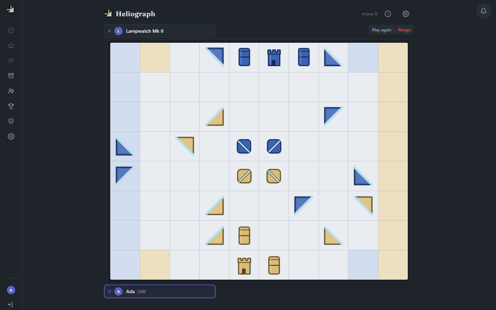
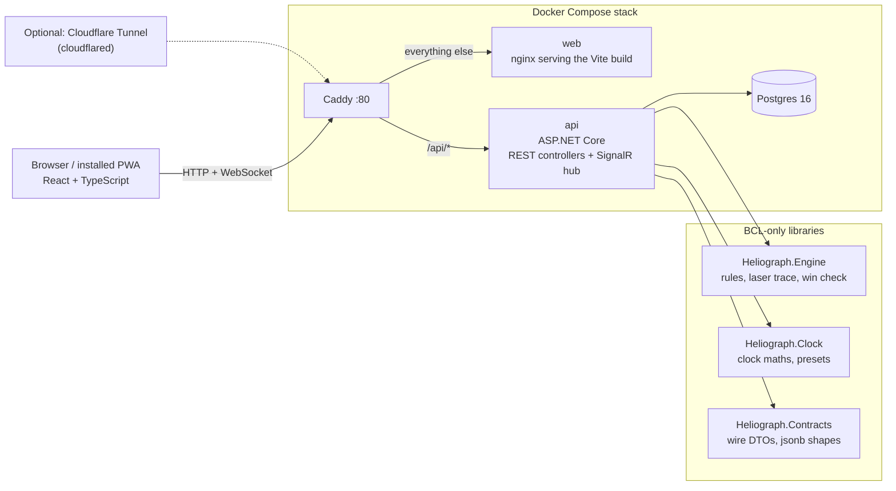

# Heliograph

Heliograph is a two-player strategy game of mirrors and light, played in the browser. Each side
moves and turns its pieces to bend a beam of sunlight across the board. After every move the
mover's beam fires, and whoever's Keep it strikes loses the game.

**Play it at [heliograph.games](https://heliograph.games).** It's self-hosted on a home server, so
it is sometimes offline. If it doesn't load, the local setup below runs the whole thing on your machine.



## Features

- **Three ways to play:** hot-seat on one device, against a bot (Easy, Medium or Hard), or online
  against a friend.
- **Two rulesets:**
  - **Fixed Sun:** the beams fire from fixed corners, and Bastions can be stacked and split.
  - **Turning Sun:** each corner holds a Heliostat you can turn as your move, and Sentinels take
    the place of Bastions.
- **Three starting setups:** Dawn, Zenith and Dusk.
- **Realtime online play** over SignalR. The server is the referee for every move, and the client
  survives reconnects. A player who vanishes can be claimed as abandoned once the grace period ends.
- **Clocks and ratings:** untimed games, Bullet, Blitz and Rapid clocks (e.g. 3+2, 10+5), and
  Daily games (days per move). Rated or casual, with a separate Elo rating per time-control
  category and a leaderboard.
- **Accounts, friends and invites:** friend requests, match invites delivered in realtime,
  rematches, resignation, avatars and profiles.
- **Game archive** with a move-by-move replay.
- **Installable PWA** on iOS and Android, with no app store.
- **Admin console** for managing accounts and games, and an in-app bug report that captures
  client-side state alongside a correlation ID threaded through the server log.

## Stack

| Layer | Choice |
|---|---|
| Backend | C# / ASP.NET Core Web API (.NET 10), SignalR for realtime, ASP.NET Core Identity + JWT |
| Game rules | `Heliograph.Engine`: a pure, BCL-only library (no EF, DI or async) |
| Frontend | React 19 + TypeScript, Tailwind CSS, Vite, Zustand, Framer Motion; installable as a PWA |
| Database | PostgreSQL 16 via EF Core (Npgsql) |
| Tests | xUnit (engine, clock, contracts, DB-backed API integration tests), Vitest + Testing Library |
| Deployment | Docker Compose: Caddy reverse proxy, the API, an nginx static frontend, Postgres |
| CI | GitHub Actions: backend build and tests against a real Postgres service, a compose image build, and frontend lint, tests and build |

## Architecture



- **The server is the referee.** The client sends one action per move over REST
  (`POST /api/games/{id}/moves`). The API validates and applies it with `Heliograph.Engine`, fires
  the beam, and persists the new board. SignalR then pushes the result to both players. The client
  mirrors the rules only to highlight legal moves; it never decides an outcome.
- **The rules engine is a pure library.** `Heliograph.Engine`, `Heliograph.Clock` and
  `Heliograph.Contracts` depend on nothing but the .NET base class library. `Heliograph.Api` is the
  only project that references them and holds all the EF, Identity, SignalR and orchestration code.
- **The board lives in a jsonb column.** A game's board state and each move's laser result are
  stored as jsonb, using the record shapes in `Heliograph.Contracts`.

For a longer guided tour (game rules, the data model, and where to make a change), see
[`.claude/context/ARCHITECTURE.md`](.claude/context/ARCHITECTURE.md).

## Repository layout

```
/backend
  Heliograph.slnx           solution file
  /api                      ASP.NET Core Web API (Heliograph.Api)
  /api.tests                xUnit tests, including DB-backed integration tests
  /Heliograph.Engine, /Heliograph.Clock, /Heliograph.Contracts   BCL-only libraries (+ .Tests projects)
/web                        React + Vite frontend
/infra
  docker-compose.yml        the full stack
  Caddyfile                 reverse proxy config
  .env.example              the values the stack reads (copy to .env)
  deploy.sh                 pull + rebuild + restart, run on the deploy host
/scripts                    small dependency-free Node helpers
/docs                       backlog specs, scoping notes, bug queue
```

The `CLAUDE.md` files and `.claude/` hold the conventions this project uses with Claude Code
agents: per-module contracts, a gotchas list, review agents and workflow skills.

## Run it locally with Docker Compose

You need Docker with the Compose plugin and Node.js (for the one-off account script). Port 80 must
be free.

1. **Configure the stack.** From the repo root:
   ```
   cp infra/.env.example infra/.env
   ```
   Edit `infra/.env` and set `POSTGRES_PASSWORD` to any value, and `JWT_SIGNING_KEY` to any string
   of at least 32 characters. You don't need the Cloudflare token or the admin email locally.

2. **Start it.** Leave out the `cloudflared` service, which only matters for a public deployment:
   ```
   docker compose -f infra/docker-compose.yml up -d --build db api web caddy
   ```
   The API applies its EF migrations on startup. Check it's up with
   `curl http://localhost/api/health`.

3. **Create your first account.** There's no self-registration, because accounts are created by an
   admin. On a fresh database, this script prints the SQL for one admin account, and you pipe it
   into Postgres:
   ```
   node scripts/create-local-account.mjs you@example.com YourName 'a-local-password' \
     | docker compose -f infra/docker-compose.yml exec -T db psql -U heliograph -d heliograph
   ```

4. **Play.** Open <http://localhost> and log in with that email (or display name) and password.
   Local Play and Play Bot need only the one account. To play online against a second person,
   create another account from **Admin → Users**.

Stop the stack with `docker compose -f infra/docker-compose.yml down`. Add `-v` to also delete the
database volume.

### Native dev loop (hot reload)

For working on the code, run Postgres in Docker and the API and frontend natively. This needs the
.NET 10 SDK and Node 22+.

```
docker compose -f infra/docker-compose.yml up -d db     # then publish 5432, or point at your own Postgres
cd backend/api
dotnet user-secrets set "ConnectionStrings:HeliographDb" "Host=localhost;Port=5432;Database=heliograph;Username=heliograph;Password=<your .env value>"
dotnet user-secrets set "Jwt:Key" "<any string of 32+ characters>"
dotnet ef database update
dotnet run                                              # http://localhost:5065
```
```
cd web
npm install
npm run dev                                             # http://localhost:5173, proxies /api/* (and the hub's WebSocket) to :5065
```

The compose file doesn't publish the database port. For the native loop, either add
`ports: ["5432:5432"]` to the `db` service in a local `docker-compose.override.yml`, or run your
own Postgres. The committed `appsettings.*.json` files hold `CHANGEME` placeholders only. Real
values go in user-secrets or environment variables, never in git.

## Tests

```
dotnet test backend/Heliograph.slnx
cd web && npm run lint && npm run test && npm run build
```

Most backend tests are pure: the game engine, the clock, and jsonb round-trips. The DB-backed
endpoint tests (`backend/api.tests/Api/`, `[Trait("Category","Integration")]`) run the API against
a real Postgres, and they **skip** rather than fail when none is reachable. Set the
`HELIOGRAPH_TEST_DB` connection-string environment variable to run them locally. CI always runs
them against a `postgres:16` service container.

## Deployment

`infra/docker-compose.yml` is also the production stack. On a server, copy `infra/.env.example` to
`infra/.env`, fill in real secrets, and run `docker compose up -d --build` from `infra/`. After
that, `infra/deploy.sh` pulls `main`, rebuilds and restarts.

Caddy serves plain HTTP on `:80`. TLS and the public hostname come from whatever sits in front of
it. The live site uses a Cloudflare Tunnel: the `cloudflared` compose service dials out, so no
inbound port is opened. Caddy sits on a small `edge` network shared only with `cloudflared`, and
it trusts `CF-Connecting-IP` from that one address. That keeps the per-IP login rate limit keyed
to the real client.

## License

Copyright © 2026 Bailey Halliday. All rights reserved. The source is public to read, but no
licence is granted to use, copy, modify or distribute it. See [`LICENSE`](LICENSE).
Third-party components remain under their own licences; see
[`THIRD_PARTY_NOTICES.md`](THIRD_PARTY_NOTICES.md).
